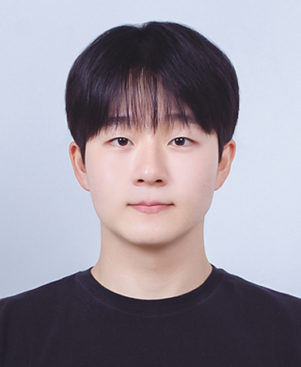

# 백승효 | AI를 서비스로 연결하는 백엔드 개발자

**AI의 속도는 활용하되, 판단과 검증은 직접 합니다.**
AI 모델과 외부 API의 결과를 그대로 화면에 내보내지 않고, 검증과 예외 처리를 거쳐 안전하게 서비스로 연결하는 백엔드를 만듭니다.

📧 shback1915@gmail.com · 🐙 [github.com/BaekSeungHyo1](https://github.com/BaekSeungHyo1)

---

## 🎓 Education

| 기간 | 내용 |
| :--: | :-- |
| 2022.03 ~ 2028.02 (졸업 예정) | 광운대학교 정보융합학부 비주얼테크놀로지전공 (3학년 재학 중)<!-- TODO: 학점 공개 여부 --> |

---

## 🛠 Tech Stack

| 분야 | 기술 |
| :-- | :-- |
| Backend |        |
| Database |      |
| Infra / DevOps |      |
| AI / Data |    -5A5A5A?style=for-the-badge)   |
| Hardware |      |
| Mobile | -34A853?style=for-the-badge&logo=android&logoColor=white)   |
| AI 개발 도구 |  -000000?style=for-the-badge)  |

---

## 🚀 Projects

### 🧪 케미체크119 — 화학사고 대응 충돌 검토 AI 서비스 (2026.07 ~ 2026.09)
> 제6회 소방안전 빅데이터활용 및 아이디어 경진대회 **입선** (2026.07 ~ 2026.08) · AI 챔피언십 출품 (2026.08.29 ~ 2026.09.20, AI 빌더 뱃지)

화학사고 신고를 AI가 분석하고, 사고 물질과 시설 안의 다른 물질이 반응할 위험을 출동대원에게 브리핑하는 서비스입니다. 3인 팀에서 **백엔드**를 맡았습니다.

- **ERD 설계와 초기 API 구조**: 사고 기록, 시설 물질, 물질 호환성 판정 도메인과 컨트롤러 작성
- **AI 브리핑 API 연동**: 응답을 반환하기 전에 요청 ID, 진행 단계·상태 값, 물질 확인 상태, 근거 존재 여부를 검사하는 검증기 구현. 형식이 어긋나면 결과를 보여주지 않고 오류로 처리
- **동시성 문제 해결**: 같은 사고의 첫 브리핑 요청이 동시에 들어올 때 생기는 저장 경합을 재시도 방식으로 해결하고, 8개 스레드 동시 요청 테스트로 검증
- **대응 기록 API**: 저장·목록·상세 조회 API와 OpenAPI 계약 문서
- **AI 활용**: Claude Code로 구현, PR마다 Codex 자동 리뷰. 리뷰 지적 사항은 실패 테스트로 먼저 재현한 뒤 수정

`Java 17` `Spring Boot` `PostgreSQL` `Flyway` `GCP Cloud Run` `GitHub Actions`

---

### 💬 HEY — AI가 먼저 말을 거는 건강 대화 서비스 (2026.07 ~ 2026.08)
> 멋쟁이사자처럼 대학 14기 중앙 해커톤 **입선** (2026.07 ~ 2026.08.25)

AI가 정해진 시각에 먼저 연락해 대화를 나누고, 대화에서 건강 정보를 추출해 기록과 리포트로 만들어 주는 서비스입니다. **백엔드**를 맡았습니다.

- JPA 엔티티 전체 설계, 회원·대화·스트릭 API DB 연동
- 대화 종료 시 AI 분석 파이프라인 트리거 연결
- **메시지 전송 안정화**: OpenAI 일시 오류(네트워크·429·5xx)만 최대 2회 재시도, Idempotency-Key로 중복 요청 방지, 대화 단위 잠금과 순번 유니크 제약으로 동시성 문제 해결
- HTTPS 전환 후 8080 포트 직접 노출 차단

`Java 17` `Spring Boot` `JPA` `MySQL(RDS)` `AWS EC2` `OpenAI API`

---

### ✍️ Writing DNA — 근대 작가 문체 분석·교육 서비스 (2026.05 ~ 2026.06)
> 텍스트마이닝 팀 프로젝트

사용자의 글을 한국 근대 작가 15명의 문체와 비교하고, 가까운 문체 유형과 작가를 알려주는 교육용 웹 서비스입니다. **모델 학습, Flask 서버, 교육 기능**을 맡았습니다.

- 품사(POS) N-gram 기반 문체 분류 모델 학습. Stratified 5-Fold 교차검증 **Macro F1 0.7535**
- 문장 단위 청크 분할, 학습과 서비스가 같은 전처리를 쓰도록 공유 모듈(`style_utils.py`) 구성
- Flask API: 문체 분석 + LLM 글쓰기 피드백, 작가 문체 변환 + **변환 결과 재분류 검증**
- 교육 기능: 작가 탐구 카드, 문체 변환 실습, 유형 학습 카드
- **AI 활용**: Claude·GPT로 코드 구조 설계, 무료인 Groq API(llama-3.3-70b)로 LLM 연동

`Python` `scikit-learn` `Kiwi` `Flask` `Groq API`
🔗 [Repository](https://github.com/BaekSeungHyo1/TM_PROJECT)

---

### 🎓 우니는졸업하고팡 — 광운대 졸업요건 통합 관리 서비스 (2026.03 ~ 2026.06)
> 멋쟁이사자처럼 14기 토이 프로젝트

흩어져 있는 졸업요건, 장학금, 수강 내역을 한곳에서 확인하는 학사 관리 서비스입니다. **백엔드**를 맡았습니다.

- KLAS 연동 Spring 백엔드, 장학금 조회 기능 구현
- 학과·학번별 JSON 규정 파일을 공통 판정 엔진으로 검사하는 졸업요건 구조
- SecurityConfig 403 오류, CORS 설정 문제 해결, feature → develop → main 브랜치 전략

`Java 21` `Spring Boot` `Spring Security` `JWT` `AWS EC2` `Nginx`
🔗 [Repository](https://github.com/LikeLion-KW-14th-Team2/BE_Repository)

---

### 🎯 AI 고무줄총 — 아군·적군 구분 자동 조준 (2026.09 ~ 2026.10)
> 피지컬AI 실습 · 중간 테스크 6발 중 4발 명중, 아군 오사격 0, 최상위 성적

라즈베리파이 카메라로 타겟을 찾아 적군만 맞히는 고무줄총입니다.

- **하드웨어 제작** 전담
- **색 측정 도구(colorlab)**: 배경과 후보 색이 카메라에 실제로 어떻게 찍히는지 측정하는 도구를 만들고, 초록(아군)·분홍(적군) 색 구분 제안
- **원격 조작 웹 대시보드**: FastAPI + WebSocket. Claude Code에 "AI는 발사를 직접 실행하지 않는다" 등 안전 규칙을 먼저 정하고 개발. 발사 기능을 뺀 나머지는 완성했지만, 대회에서는 위험을 줄이려고 검증된 기존 방식(VNC)을 사용
- 데이터 수집 참여(촬영, 거리 조절)

`Python` `Raspberry Pi` `OpenCV` `FastAPI` `WebSocket` `Claude Code`
🔗 [팀 Repository](https://github.com/chlwjddls0923/auto_aim_turret)

---

### 🤖 temi 도서관 안내 로봇 (2026.09 ~ 진행 중)
> 모바일로봇의이해 D조 **팀장**

책 추천부터 서가까지 동행 안내를 temi 로봇 하나로 잇는 도서관 안내 서비스입니다.

- 팀장으로 UI/UX, 발표, 기업 멘토링 보고서 작성
- 상태 기반 제어(대기·이동·도착 안내·예외) 구조와 예외 처리 설계
- 기존 검색 PC 방식과 비교하는 교차 순서 사용성 평가 설계(SUS, 성공률, 소요 시간)

`Kotlin` `Jetpack Compose` `temi SDK` `ML Kit`

---

### 🦾 로봇팔 제어 (2026.10 ~ 진행 중)
> 피지컬AI 실습 기말 테스크

- Dofbot 로봇팔 하드웨어 제작 담당 <!-- TODO: 기말 테스크 내용이 나오면 추가 -->

---

### 📚 수업 프로젝트

| 학기 | 과목 | 프로젝트 |
| :--: | :-- | :-- |
| 2026-1 | 매치업 로봇산업입문 | **피터 앵커** — 거미줄형 비상 그물 흡착망 AI 안전 웨어러블 로봇 기획 (실무보고서·포스터 부문 우수상) |
| 2025-2 | 모바일프로그래밍 | 나는 과연 졸업할 수 있을까? — 학번별 졸업요건 자동 계산 Android 앱 (SQLite) |
| 2025-2 | 정보디자인프로그래밍 | 데이터 시각화 팀 프로젝트 (FastAPI 기반 CSV 데이터 API 활용) |
| 2025-1 | 빅데이터 프로그래밍 | 음주운전 사고 분석 및 단속 강화 방안 제시 (공공데이터 분석) |
| 2025-1 | 객체지향프로그래밍 | 영화관 예매 시스템 객체지향 설계 (Java) |
| 2025-1 | 오픈소스소프트웨어 | Streamlit 웹 앱, Jekyll 포트폴리오 사이트 |
<!-- TODO: 각 수업 프로젝트에서 맡은 역할 한 줄씩 추가 -->

---

## 🏆 Awards

| 기간 | 내용 |
| :--: | :-- |
| 2026.07 ~ 2026.08.25 | 멋쟁이사자처럼 대학 14기 중앙 해커톤 입선 |
| 2026.07 ~ 2026.08 | 제6회 소방안전 빅데이터활용 및 아이디어 경진대회 입선 |
| 2026.03 ~ 2026.06 | 제5회 매치업 심화과정 경진대회 로봇분야 **우수상** (실무보고서·포스터 부문) |
| 2026 | 제3회 CHIC 해커톤 — AI 활용 ESG 아이디어톤 입선 (3학년 여름방학) |
| 2025 | CHIC 여름방학 아이디어톤 — 노원구 백사마을 주민을 위한 서비스 입선 (2학년 여름방학) |

---

## 📜 Certificates & Badges

| 기간 | 내용 |
| :--: | :-- |
| 2026.08.29 ~ 2026.09.20 | AI 빌더 뱃지 (AI 챔피언십 참가) |
| 2026.03 ~ 2026.06 | 광운대학교 산업맞춤 단기직무능력인증과정(매치업) **바이오헬스 분야** 디지털배지 3종 이수 · 이수증 웨어러블 로봇 시장 분석과 제품 개발 기획 보고서 실무 / 웨어러블 로봇과 인간 동기화를 위한 센서 및 인체공학의 이해 / IoT 헬스케어 서비스 및 제품의 이해 |
| 2025.02 | 컴퓨터활용능력 2급 취득 |

---

## 🤝 Activities

| 기간 | 내용 |
| :--: | :-- |
| 2026.09 ~ 현재 | 링커스 20기 — AI·SW 개발 직무 탐구, 현직자 인터뷰, 직무 이슈 보고서 작성 |
| 2026.09 ~ 현재 | 히어로스쿨 코치 — 김포고등학교 '기업가정신' 수업 출강 (2026.09.04 ~ 2026.10.16 진행, 이후 활동 계속) |
| 2026.03 ~ 현재 | 광운대학교 멋쟁이사자처럼 14기 (백엔드) |
| 2025.08 ~ 현재 | 학과 풋살 소모임 ICFC **회장** |
| 2025.03 ~ 현재 | 광운대학교 학술소모임 CHIC |
| 2024.09 ~ 현재 | 경기도 학생승마 지원사업 — 산들래승마장, 초·중등 대상 레슨 보조 |

---

## 💡 How I Work with AI

- **역할을 나눈다**: 구현은 Claude Code, 리뷰는 Codex처럼 도구마다 역할을 정합니다.
- **권한의 경계를 먼저 정한다**: 하드웨어처럼 위험이 있는 작업에서는 AI가 하지 말아야 할 일을 규칙으로 먼저 적습니다.
- **지적은 재현한 뒤 고친다**: AI 리뷰 결과도 테스트로 재현해 확인한 뒤 수정합니다.
- **약점은 숨기지 않는다**: 낮은 성능이나 한계도 원인과 함께 공개합니다.
